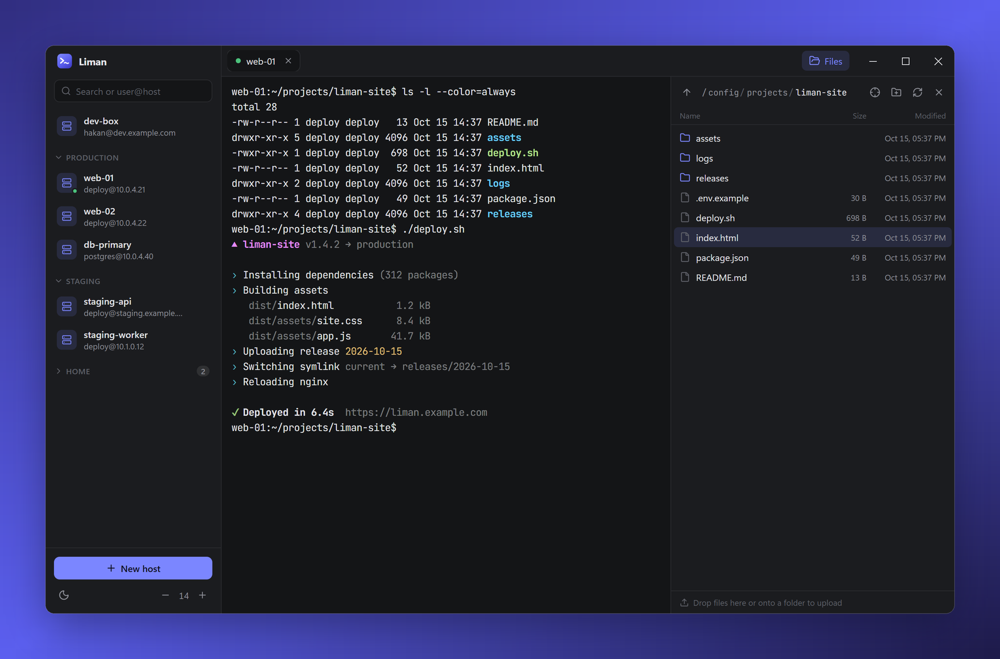
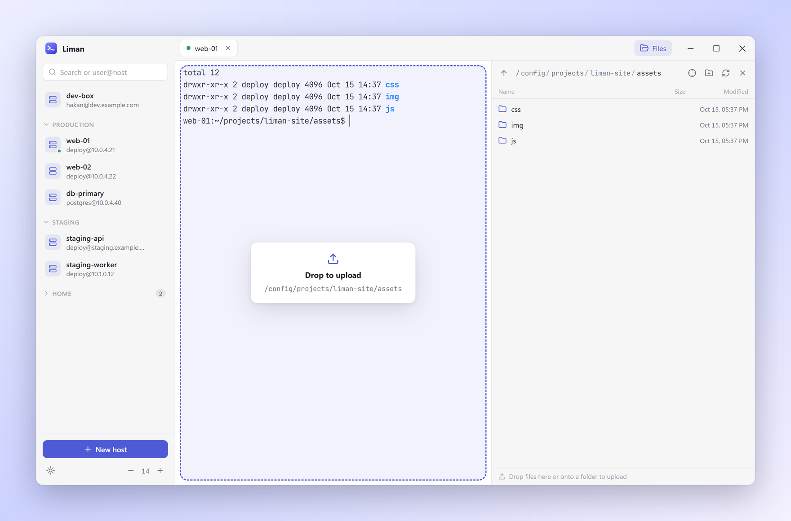
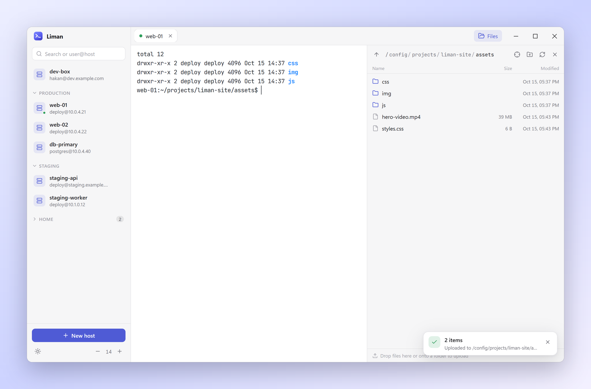

<p align="center">
  
</p>

<h1 align="center">Liman</h1>

<p align="center">
  A minimal SSH + SFTP client for Windows and macOS. Inspired by Termius, focused on being simple to use.<br>
  <a href="https://github.com/hakan-krgn/liman/actions/workflows/build-and-test.yml"></a>
  <a href="https://github.com/hakan-krgn/liman/releases/latest"></a>
</p>

<p align="center">
  
</p>

## Install

Download the latest installer from [Releases](https://github.com/hakan-krgn/liman/releases):

- **Windows:** run `Liman-Setup-<version>.exe`, choose a folder, and Liman is added to the Start menu and desktop. Uninstall it from *Settings → Apps*. The installer isn't code-signed yet, so SmartScreen may ask you to confirm (*More info → Run anyway*).
- **macOS:** open `Liman-<version>-mac-universal.dmg` and drag Liman into *Applications*. The app is ad-hoc signed but not notarized, so the first time right-click it and choose *Open* (or run `xattr -cr /Applications/Liman.app`).

**Updates:** Liman checks GitHub Releases at startup and every few hours. On Windows the new version downloads in the background and installs when you click *Restart to update* (or the next time you quit). On macOS you get a notice with a link to the download. Your hosts, passwords and settings are kept across updates.

## Drop files onto the terminal

Drag anything from your desktop onto a terminal: Liman finds the folder that shell is in right now and uploads there. The SFTP panel follows along, so the new files show up as soon as they land.

<table>
  <tr>
    <td width="50%"></td>
    <td width="50%"></td>
  </tr>
  <tr>
    <td align="center"><sub>The target folder is shown before you let go</sub></td>
    <td align="center"><sub>Parallel transfers with progress, then the panel refreshes</sub></td>
  </tr>
</table>

## Features

- **Drag-and-drop uploads:** Drop files or folders from the desktop, Explorer or Finder onto a terminal and they are uploaded to whatever directory that terminal is currently in. The target directory is shown before you drop.
- **SFTP panel:** Browse folders, drop onto a folder to upload into it, double-click to download (to your Downloads folder), rename, delete, create folders, and jump to the terminal's current directory.
- **Drag-and-drop downloads:** Drag files or folders out of the SFTP panel onto the desktop or an Explorer / Finder window and they are downloaded right where you drop them. On macOS, Liman asks once for permission to see which Finder windows are open.
- **Copy and paste files:** In the SFTP panel, Ctrl+C (⌘C) copies files and folders; paste them in Explorer, Finder or on the desktop and they are downloaded right there (paste as often as you like). Files copied in Explorer or Finder, and screenshots (as PNG), are uploaded with Ctrl+V in the panel; in a terminal, Ctrl+V offers to upload them into its current folder. Pasting in another server's panel copies between the servers; Ctrl+X then Ctrl+V on the same server moves, and a copy next to its original is named `file (copy).txt`. Copies within one server run on the server itself.
- **Keyboard:** every action has a shortcut: move through files with the arrow keys, type a name to jump to it, filter a folder, go back and forward, refresh with F5, find in the terminal. Press F1 for the full list, change any key in *Settings › Shortcuts*, or see [Shortcuts](#shortcuts).
- **Conflict handling:** If a file with the same name already exists you can choose *Keep both* (`file (1).txt`), *Replace* or *Cancel*.
- **Instant typing:** on distant servers, what you type and delete shows at once instead of after the server's echo (like Mosh). Liman checks every guess against what the server sends and drops wrong ones, and it never guesses at password prompts or in full-screen programs such as vim. Toggle it with the ⚡ button in the sidebar.
- **Settings** (⚙ in the sidebar, Ctrl+, / ⌘,): app theme, terminal colour presets (One Dark, Dracula, Solarized, Nord, Gruvbox, …), font, size, line height and cursor; scrollback, copy on select, right-click menu, a warning before pasting several lines, the bell; hidden files, what to do when a name is taken, where downloads go; reconnecting, keepalive and timeouts; updates. Changes apply at once.
- **Light / dark / system theme**; terminal font zoom with Ctrl/Cmd + scroll or Ctrl/Cmd + = / - / 0.
- **Organised host list:** drag hosts and groups into any order, move hosts between groups, collapse groups you don't need.
- **Authentication:** password, SSH key (including passphrase-protected keys), SSH agent, and keyboard-interactive (2FA).
- **Security:** Host key fingerprints are confirmed on first connect and you are warned if they change. Passwords are encrypted with the operating system's keychain (`safeStorage`).
- Tabs, quick connect (type `user@host:port` in the search box and press Enter), right-click to copy / paste.

## Development

```bash
npm install
npm run dev          # run in development mode
npm run typecheck
npm test             # unit tests (+ integration tests when LIMAN_TEST_SSH is set)
npm run dist:win     # Windows installer (in release/)
npm run dist:mac     # macOS .dmg — must be run on macOS
```

The integration tests in `test/integration` talk to a real OpenSSH server:

```bash
docker run -d --name liman-ssh -p 127.0.0.1:2222:2222 -e PASSWORD_ACCESS=true \
  -e USER_NAME=tester -e USER_PASSWORD=test123 lscr.io/linuxserver/openssh-server
LIMAN_TEST_SSH=127.0.0.1:2222 npm test
```

## Releases

- **Build and Test** (`.github/workflows/build-and-test.yml`) runs on every push and pull request to `master`: typecheck, unit and integration tests against an OpenSSH container, a production build, and a packaging check on Windows and macOS.
- **Release Pipeline** (`.github/workflows/release-pipeline.yml`) runs when a GitHub release is published. It repeats the checks, sets the app version from the tag (`v1.2.3` → `1.2.3`), builds the Windows installer and the macOS disk image, and attaches both to the release.

To ship a version: create a release with a tag such as `v0.2.0` on GitHub (*Releases → Draft a new release → Publish*), and the installers appear on it a few minutes later.

## Shortcuts

On Windows and Linux the terminal sends Ctrl+letter keys to the shell (Ctrl+W deletes a word, Ctrl+R searches history), so Liman's own shortcuts there use Ctrl+Shift. Where a key does two things, the place you're in wins: F2 renames a file in the files panel and the tab elsewhere. Any of them can be changed in *Settings › Shortcuts* (click a key, press the new one); Liman refuses keys the system keeps for itself and warns before taking one from the shell. The tables below are the defaults; F1 in the app shows yours.

<!-- shortcuts:start -->

### Everywhere

| Action | Windows / Linux | macOS |
|---|---|---|
| Next tab | `Ctrl+Tab` | `⌃Tab` |
| Previous tab | `Ctrl+Shift+Tab` | `⌃⇧Tab` |
| Go to tab 1–9 | `Ctrl+1…9` | `⌘1…9` |
| New connection (search hosts) | `Ctrl+Shift+T` | `⌘T` |
| Duplicate tab | `Ctrl+Shift+D` | `⇧⌘D` |
| Reconnect | `Ctrl+Shift+R` | `⇧⌘R` |
| Close tab | `Ctrl+Shift+W` | `⌘W` |
| Rename tab | `F2` | `F2` |
| Show or hide the files panel | `Ctrl+Shift+E` | `⇧⌘E` |
| Larger text | `Ctrl+=` | `⌘=` |
| Smaller text | `Ctrl+-` | `⌘-` |
| Default text size | `Ctrl+0` | `⌘0` |
| Keyboard shortcuts | `F1` | `F1` |
| Settings | `Ctrl+,` | `⌘,` |

### Terminal

| Action | Windows / Linux | macOS |
|---|---|---|
| Copy the selection | `Ctrl+Shift+C` / `Ctrl+C` | `⌘C` |
| Paste (files are uploaded here, after asking) | `Ctrl+Shift+V` / `Ctrl+V` | `⌘V` |
| Find | `Ctrl+Shift+F` | `⌘F` |
| Clear the screen and scrollback | `Ctrl+Shift+L` | `⌘K` |
| Delete the previous / next word | `Ctrl+Backspace` / `Ctrl+Delete` | `⌥⌫` |

### Files panel

| Action | Windows / Linux | macOS |
|---|---|---|
| Copy (paste in Explorer / Finder, or in Liman) | `Ctrl+C` | `⌘C` |
| Cut (paste in Liman to move) | `Ctrl+X` | `⌘X` |
| Paste here (files, a screenshot, or what Liman copied) | `Ctrl+V` | `⌘V` |
| Refresh | `F5` / `Ctrl+R` | `⌘R` |
| Open folder / download file | `Enter` | `Enter` / `⌘↓` |
| Parent folder | `Backspace` / `Alt+↑` | `⌘↑` |
| Back | `Alt+←` | `⌘[` |
| Forward | `Alt+→` | `⌘]` |
| Rename | `F2` | `F2` |
| Delete | `Delete` | `⌘⌫` |
| New folder | `Ctrl+Shift+N` | `⇧⌘N` |
| Download to the Downloads folder | `Ctrl+S` | `⌘S` |
| Copy path | `Ctrl+Shift+C` | `⌥⌘C` |
| Go to this folder in the terminal | `Ctrl+Enter` | `⌘Enter` |
| Filter this folder | `Ctrl+F` | `⌘F` |
| Type a path to go to | `Ctrl+L` | `⇧⌘G` |
| Select all | `Ctrl+A` | `⌘A` |
| Cancel a cut, then clear the selection | `Esc` | `Esc` |
| Move through the list (Shift extends the selection) | `↑` `↓` `Home` `End` `PgUp` `PgDn` | `↑` `↓` `Home` `End` `PgUp` `PgDn` |
| Jump to the first name starting with what you type | Type the start of a name | Type the start of a name |

### Host list

| Action | Windows / Linux | macOS |
|---|---|---|
| Move through the hosts | `↑` / `↓` | `↑` / `↓` |
| Connect | `Enter` | `Enter` |
| Edit host | `F2` | `F2` |
| Delete host | `Delete` | `⌘⌫` |

<!-- shortcuts:end -->

## How the terminal's directory is detected

The login shell is started so that its PID is known up front (`SHELL_BOOTSTRAP` in `src/main/ssh.ts`). When files are dropped, the working directory of the terminal's foreground process is read over a separate helper channel (`/proc` on Linux, `lsof` on macOS/BSD). Nothing is ever typed into your terminal. If that isn't possible, Liman falls back to the directory reported by the shell via OSC 7, and finally to the home directory.

## Performance notes

- Folder listings are cached per session and refreshed in the background; hovering a folder prefetches it.
- Directory reads are pipelined, and cwd lookups reuse one long-lived helper channel instead of opening a new one each time.
- Uploads and downloads move up to 8 files at once on their own SFTP channel, so cancelling a transfer never disturbs browsing.
- The terminal renders with WebGL (falling back to the DOM renderer) and Nagle's algorithm is disabled on the SSH socket.

## Project layout

```
src/main/      Electron main process: SSH/SFTP engine (ssh2), settings and host store
src/preload/   Safe API exposed to the renderer
src/renderer/  React UI (xterm.js terminal)
src/shared/    Shared types
```
