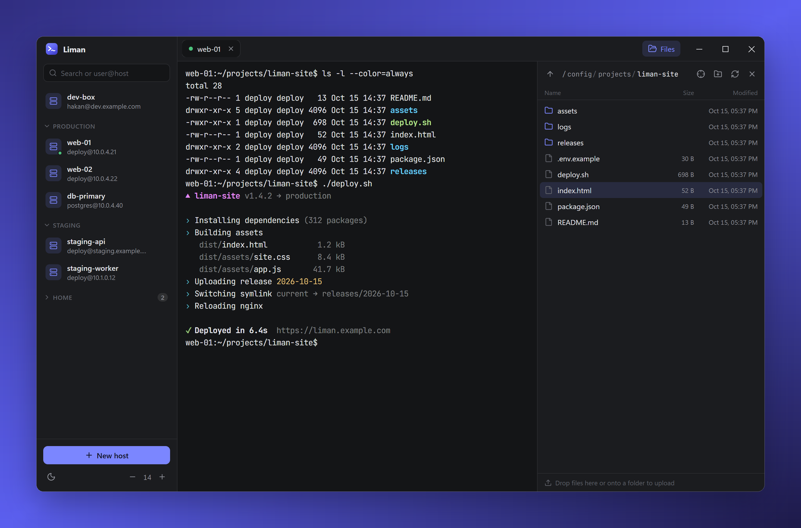
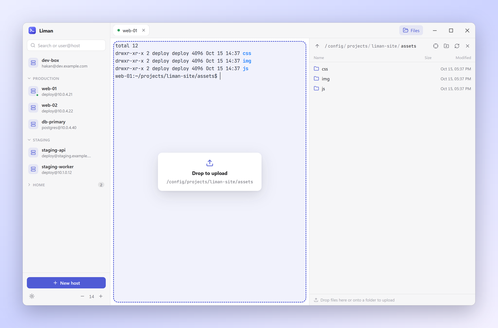
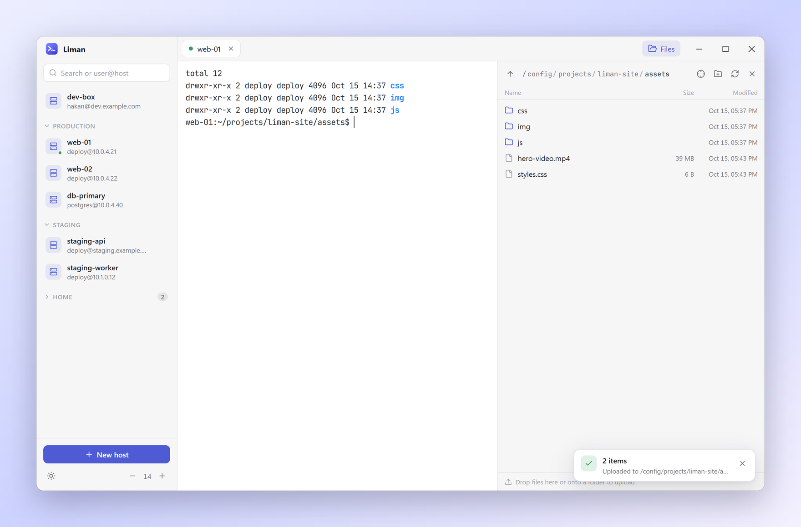

<p align="center">
  
</p>

<h1 align="center">Liman</h1>

<p align="center">
  A minimal SSH + SFTP client for Windows and macOS. Inspired by Termius, focused on being simple to use.<br>
  <a href="https://github.com/hakan-krgn/liman/actions/workflows/build-and-test.yml"></a>
  <a href="https://github.com/hakan-krgn/liman/releases/latest"></a>
</p>

<p align="center">
  
</p>

## Install

Download the latest installer from [Releases](https://github.com/hakan-krgn/liman/releases):

- **Windows:** run `Liman-Setup-<version>.exe`, choose a folder, and Liman is added to the Start menu and desktop. Uninstall it from *Settings → Apps*. The installer isn't code-signed yet, so SmartScreen may ask you to confirm (*More info → Run anyway*).
- **macOS:** open `Liman-<version>-mac-universal.dmg` and drag Liman into *Applications*. The app is ad-hoc signed but not notarized, so the first time right-click it and choose *Open* (or run `xattr -cr /Applications/Liman.app`).

**Updates:** Liman checks GitHub Releases at startup and every few hours. On Windows the new version downloads in the background and installs when you click *Restart to update* (or the next time you quit). On macOS you get a notice with a link to the download. Your hosts, passwords and settings are kept across updates.

## Drop files onto the terminal

Drag anything from your desktop onto a terminal: Liman finds the folder that shell is in right now and uploads there. The SFTP panel follows along, so the new files show up as soon as they land.

<table>
  <tr>
    <td width="50%"></td>
    <td width="50%"></td>
  </tr>
  <tr>
    <td align="center"><sub>The target folder is shown before you let go</sub></td>
    <td align="center"><sub>Parallel transfers with progress, then the panel refreshes</sub></td>
  </tr>
</table>

## Features

- **Drag-and-drop uploads:** Drop files or folders from the desktop, Explorer or Finder onto a terminal and they are uploaded to whatever directory that terminal is currently in. The target directory is shown before you drop.
- **SFTP panel:** Browse folders, drop onto a folder to upload into it, double-click to download (to your Downloads folder), rename, delete, create folders, and jump to the terminal's current directory.
- **Conflict handling:** If a file with the same name already exists you can choose *Keep both* (`file (1).txt`), *Replace* or *Cancel*.
- **Light / dark / system theme**; terminal font zoom with Ctrl/Cmd + scroll or Ctrl/Cmd + = / - / 0.
- **Organised host list:** drag hosts and groups into any order, move hosts between groups, collapse groups you don't need.
- **Authentication:** password, SSH key (including passphrase-protected keys), SSH agent, and keyboard-interactive (2FA).
- **Security:** Host key fingerprints are confirmed on first connect and you are warned if they change. Passwords are encrypted with the operating system's keychain (`safeStorage`).
- Tabs, quick connect (type `user@host:port` in the search box and press Enter), right-click to copy / paste.

## Development

```bash
npm install
npm run dev          # run in development mode
npm run typecheck
npm test             # unit tests (+ integration tests when LIMAN_TEST_SSH is set)
npm run dist:win     # Windows installer (in release/)
npm run dist:mac     # macOS .dmg — must be run on macOS
```

The integration tests in `test/integration` talk to a real OpenSSH server:

```bash
docker run -d --name liman-ssh -p 127.0.0.1:2222:2222 -e PASSWORD_ACCESS=true \
  -e USER_NAME=tester -e USER_PASSWORD=test123 lscr.io/linuxserver/openssh-server
LIMAN_TEST_SSH=127.0.0.1:2222 npm test
```

## Releases

- **Build and Test** (`.github/workflows/build-and-test.yml`) runs on every push and pull request to `master`: typecheck, unit and integration tests against an OpenSSH container, a production build, and a packaging check on Windows and macOS.
- **Release Pipeline** (`.github/workflows/release-pipeline.yml`) runs when a GitHub release is published. It repeats the checks, sets the app version from the tag (`v1.2.3` → `1.2.3`), builds the Windows installer and the macOS disk image, and attaches both to the release.

To ship a version: create a release with a tag such as `v0.2.0` on GitHub (*Releases → Draft a new release → Publish*), and the installers appear on it a few minutes later.

## Shortcuts

| Action | Windows | macOS |
|---|---|---|
| Copy / Paste | Ctrl+C (with a selection) / Ctrl+V, or right-click | Cmd+C / Cmd+V |
| Close tab | Ctrl+Shift+W | Cmd+W |
| Switch tab | Ctrl+Tab, Ctrl+1…9 | Ctrl+Tab, Cmd+1…9 |

## How the terminal's directory is detected

The login shell is started so that its PID is known up front (`SHELL_BOOTSTRAP` in `src/main/ssh.ts`). When files are dropped, the working directory of the terminal's foreground process is read over a separate helper channel (`/proc` on Linux, `lsof` on macOS/BSD). Nothing is ever typed into your terminal. If that isn't possible, Liman falls back to the directory reported by the shell via OSC 7, and finally to the home directory.

## Performance notes

- Folder listings are cached per session and refreshed in the background; hovering a folder prefetches it.
- Directory reads are pipelined, and cwd lookups reuse one long-lived helper channel instead of opening a new one each time.
- Uploads and downloads move up to 8 files at once on their own SFTP channel, so cancelling a transfer never disturbs browsing.
- The terminal renders with WebGL (falling back to the DOM renderer) and Nagle's algorithm is disabled on the SSH socket.

## Project layout

```
src/main/      Electron main process: SSH/SFTP engine (ssh2), settings and host store
src/preload/   Safe API exposed to the renderer
src/renderer/  React UI (xterm.js terminal)
src/shared/    Shared types
```
